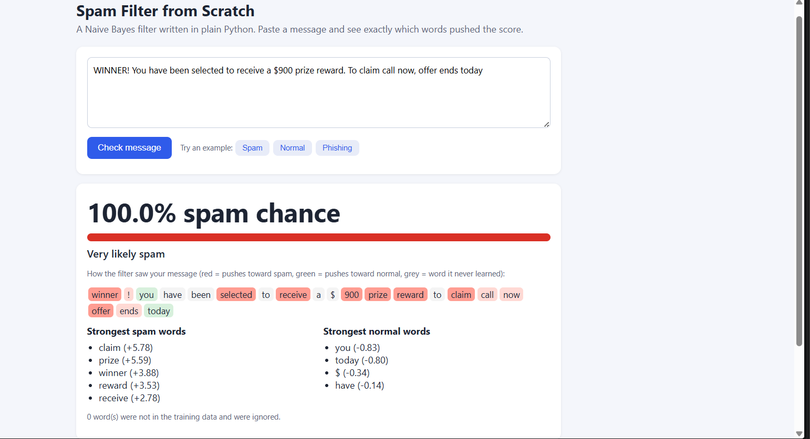

# Spam Filter from Scratch

A spam filter written in plain Python. It uses the Naive Bayes method, with no machine learning library. You paste a message in a Flask web page and see the spam chance, plus how much each word pushed the score.

## Results

Trained on 4,459 real SMS messages. Tested on 1,115 messages it had never seen.

| | Predicted spam | Predicted normal |
|---|---|---|
| **Really spam** | 145 | 14 |
| **Really normal** | 5 | 951 |

- Accuracy: 98.3%
- Precision: 96.7% (of 150 messages flagged as spam, 145 really were)
- Recall: 91.2% (of 159 real spam messages, 145 were caught)

## How it works

1. The message is split into lowercase words.
2. In training, each word is counted in spam and in normal messages. The 4,459 training messages contain 7,727 different words.
3. Each class gets a score: log(share of messages in that class) + the sum of log P(word | class).
4. Every count gets +1 (Laplace smoothing). A word never seen in one class then does not give a zero chance.
5. The two scores become a percent: 1 / (1 + e^-(spam score - normal score)).

The number next to each word on the page is log P(word | spam) - log P(word | normal). Example: the saved model gives "claim" +5.78, and e^5.78 is about 324. So "claim" is about 324 times more likely in spam than in normal messages.

## Limits

- It learned from SMS messages. Long emails may score worse.
- It counts words and ignores word order.
- Short normal messages can be flagged. "No calls..messages..missed calls" was wrongly flagged in the test.
- English only.

## Run it

Install and start:

    pip install -r requirements.txt
    python app.py

Then open http://127.0.0.1:5000

`model.json` is included, so the page works right away. To train again from the real dataset (it downloads automatically, about 200 KB):

    python train_real.py

The saved `model.json` is trained on all 5,574 messages. The results table above comes from the 80% / 20% split.

## Files

- `classifier.py`: the Naive Bayes classifier and a small demo on 40 sample messages
- `train_real.py`: downloads the dataset, trains, tests, and saves `model.json`
- `app.py`: the Flask web page and `/api/check` endpoint
- `test_app.py`: self-test without a browser
- `data/sample_messages.csv`: the 40 sample messages

## Data

SMS Spam Collection, UCI Machine Learning Repository: https://archive.ics.uci.edu/dataset/228/sms+spam+collection

Almeida, T. A., Gomez Hidalgo, J. M., Yamakami, A. (2011). Contributions to the Study of SMS Spam Filtering: New Collection and Results. ACM Symposium on Document Engineering (DocEng 2011).
